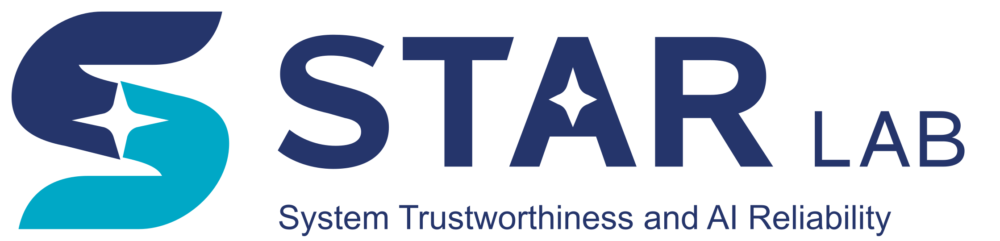

  <picture>
    <source media="(prefers-color-scheme: dark)" srcset="star-signature-reverse.png">
    
  </picture>

  <b>STAR Lab · System Trustworthiness and AI Reliability</b> 
  George Mason University

---

We build and study computing systems that people can trust, from the
AI models that now write and run code to the software and infrastructure
they run on.

### Research areas

- **AI reliability**: robustness, correctness, and failure analysis of ML and LLM-based systems
- **Software engineering**: testing, analysis, and repair, for and with AI
- **System security**: finding and preventing vulnerabilities in real-world software
- **ML systems**: efficient and dependable training and inference infrastructure

### Featured projects

<!-- Pin your best repositories on the org page, and list them here. -->
| Project | Description | Paper |
|---|---|---|
| [STAR-paper-template](https://github.com/STAR-Computing/STAR-paper-template) | Lab LaTeX template for single- and double-column papers (Overleaf-ready) | — |
| _your-tool_ | _One-line description_ | _Venue Year_ |

### Join us

<!-- Replace with your lab website and contact details. -->
We are looking for motivated students interested in trustworthy AI and systems.
See our [lab website](https://example.org) for openings.
